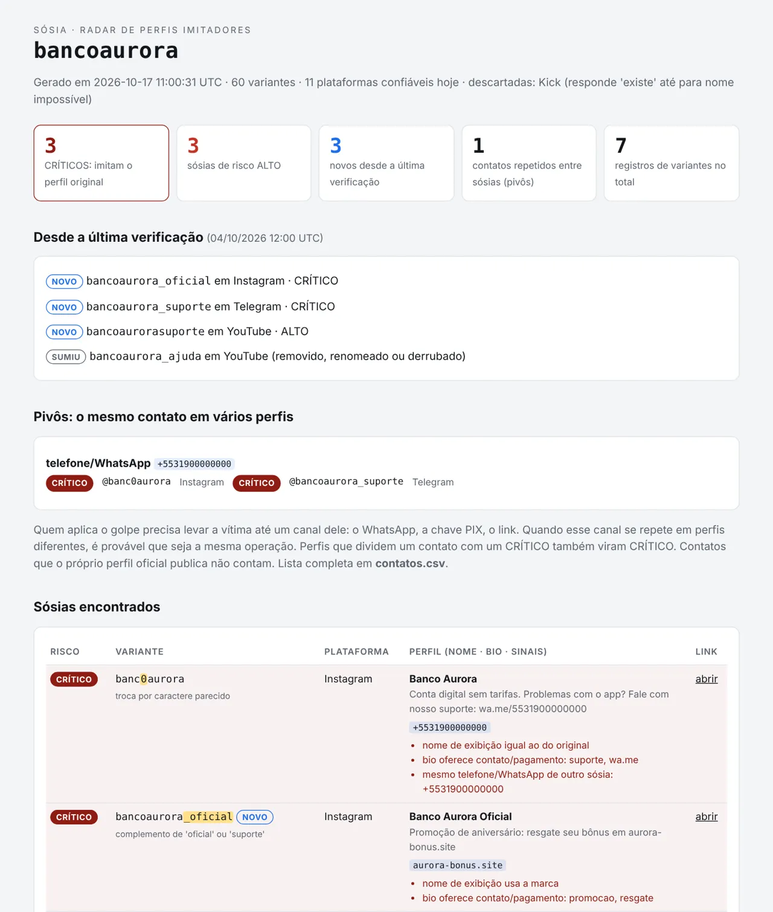
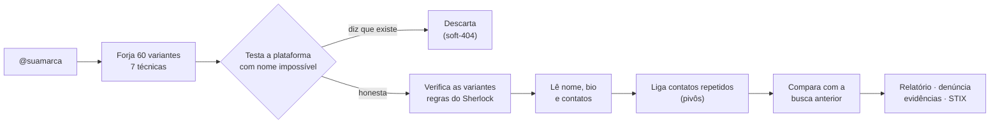
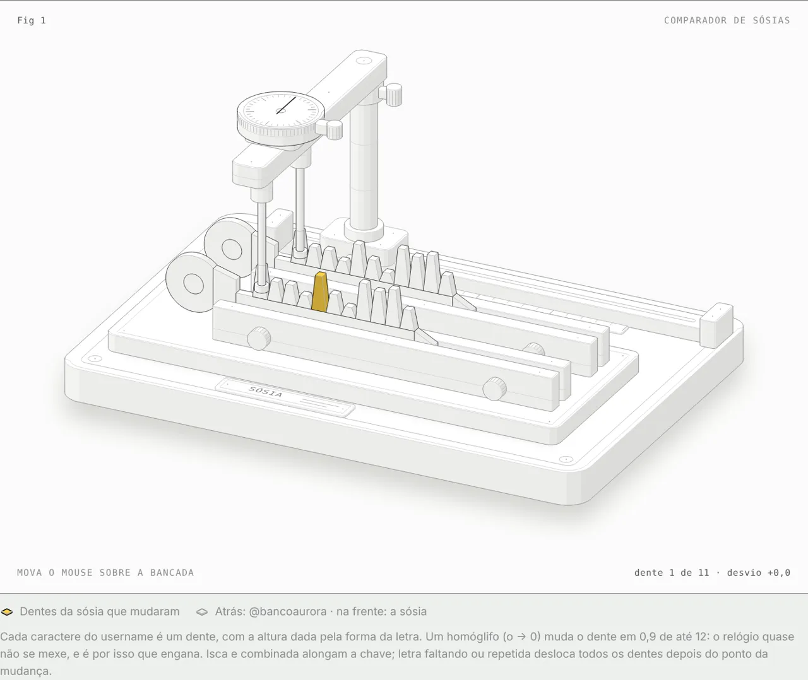
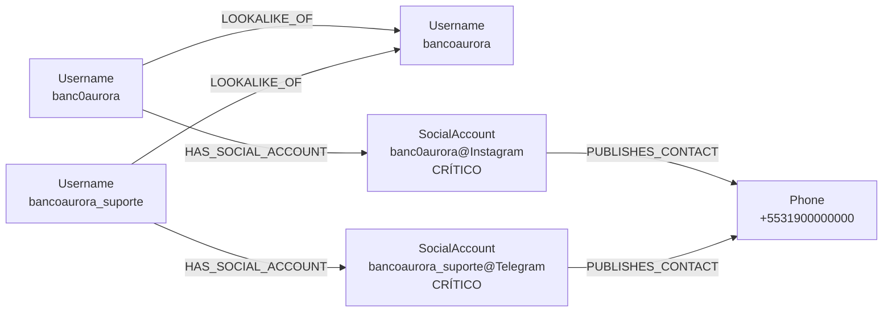

# SÓSIA 1.2 · radar de perfis imitadores

> Sherlock e Maigret procuram o nome **exato**. Golpista usa o nome **quase** exato.

O SÓSIA gera os nomes quase iguais ao de uma marca ou pessoa (`banc0aurora`, `bancoaurora_suporte`, `banc0aurora_oficial`…) e verifica em quais plataformas eles já estão registrados. Depois lê nome e bio de cada perfil para apontar quem **imita** o original. Ele também **liga perfis que publicam o mesmo WhatsApp, PIX ou link**, guarda cada página como **evidência com SHA-256** e entrega a **denúncia pronta**, com o canal oficial de cada plataforma.

Uso defensivo: proteção de marca, de instituições e de pessoas expostas contra perfis falsos usados em golpe de "suporte", PIX e falso atendimento.



## Em 30 segundos

```bash
python sosia.py --demo        # caso fictício, sem internet
python sosia.py suamarca      # busca real (3 a 5 minutos)
python sosia.py --help        # todas as opções
```

Sem terminal: dois cliques em `Iniciar-SOSIA.bat` (Windows), `Iniciar-SOSIA.command` (macOS) ou `iniciar-sosia.sh` (Linux) e digite `DEMO`.

- Python 3.9 a 3.14, **só biblioteca padrão**: nada de `pip install`
- Lê o `data.json` do [Sherlock](https://github.com/sherlock-project/sherlock) sem modificação (`--sites data.json`)
- 36 testes automáticos, todos sem internet (`python -m unittest discover -s tests -v`)

| Para… | Abra |
|---|---|
| começar agora | [`COMECE-AQUI.md`](COMECE-AQUI.md) |
| aprender jogando, um passo por vez | [`GUIA-INTERATIVO.html`](GUIA-INTERATIVO.html): o caso Banco Aurora em 6 capítulos |
| instalar, entender cada tela, resolver problemas | [`MANUAL.html`](MANUAL.html) |
| ver o que foi testado | [`RELATORIO-DE-TESTES.md`](RELATORIO-DE-TESTES.md) |
| ver o que mudou | [`CHANGELOG.md`](CHANGELOG.md) |

## Como funciona



1. **Forja.** Homóglifo (`o→0`, `m→rn`), isca (`_suporte`, `_oficial`), as duas juntas (combinada), separador, letra repetida, faltando ou invertida. Metade da lista vai para as três técnicas que mais enganam.
2. **Testa a porta.** Antes de confiar numa plataforma, consulta um nome que não pode existir. Se ela disser "existe", é descartada naquela busca. Bloqueio, limite e anti-robô viram "?", nunca "livre".
3. **Lê o perfil.** Vira **CRÍTICO** quem copia o nome ou a bio do original, ou quem usa a marca no nome **e** oferece suporte, PIX ou WhatsApp. A marca sozinha não basta (fãs e revendedores).
4. **Liga os perfis** *(1.2)*. Um WhatsApp escrito como `wa.me/5531900000000` num perfil e `(31) 90000-0000` em outro é reconhecido como o mesmo número. Quem divide contato com um CRÍTICO vira CRÍTICO.
5. **Ronda.** Na próxima busca da mesma marca, mostra o que é **NOVO** e o que **SUMIU**.



## O que sai de cada busca

```
resultados/sosia_suamarca_20261017-080000/
├── relatorio.html       abra este primeiro
├── denuncia.md          canal oficial + sinais + evidência + texto pronto, por plataforma
├── achados.csv          sósias encontrados (abre no Excel)
├── contatos.csv         WhatsApp, PIX, e-mail, Telegram, CNPJ e links das bios
├── mudancas.csv         NOVO / SUMIU desde a busca anterior
├── evidencias/          cada página lida, como chegou, em .html.txt (não executa nada)
├── achados.stix.json    STIX 2.1 para OpenCTI, MISP e afins
├── variantes.txt        as 60 variantes, para listas de bloqueio
├── dados.json           tudo, em bruto
└── manifesto.txt        SHA-256 de todos os arquivos acima
```

Trecho do `denuncia.md` no caso demo:

```markdown
## Contatos que ligam os perfis
- **telefone/WhatsApp `+5531900000000`**: @banc0aurora (Instagram), @bancoaurora_suporte (Telegram)

## Instagram
Canal: Formulário de falsificação de identidade: https://help.instagram.com/contact/636276399721841

### @banc0aurora · CRÍTICO
- Sinal: nome de exibição igual ao do original
- Sinal: bio oferece contato/pagamento: suporte, wa.me
- Evidência: `evidencias/01_Instagram_banc0aurora.html.txt` · HTTP 200 · SHA-256 `9c2833cd…`
```

## Comparado com as ferramentas de username

| | Sherlock | Maigret | SÓSIA |
|---|:-:|:-:|:-:|
| Procura o nome exato | ✔ | ✔ | (o original vira linha de controle) |
| Gera e verifica nomes **quase** iguais | – | – | ✔ 7 técnicas |
| Descarta plataforma que mente (soft-404) | – | parcial | ✔ teste com nome impossível |
| Diz se o perfil **imita** o original | – | – | ✔ nome, bio e iscas de golpe |
| Liga perfis pelo mesmo WhatsApp/PIX/link | – | – | ✔ |
| Evidência com SHA-256 e kit de denúncia | – | – | ✔ |
| Monitoramento NOVO / SUMIU | – | – | ✔ |
| Exporta STIX 2.1 | – | – | ✔ |
| Plataformas | 400+ | 3000+ | 12 (aceita o `data.json` do Sherlock) |

O SÓSIA não substitui os dois: ele responde a outra pergunta. Para varrer o nome exato em centenas de sites, use o Sherlock ou o Maigret.

## No OsintbrFLOW

O enriquecedor `username_to_impersonators` (categoria *social*) usa esta mesma biblioteca. A cópia em `flowsint-enrichers/src/tools/social/` é conferida byte a byte pelos testes. No grafo:



Os parâmetros são `max_variantes`, `risco_minimo`, `ler_perfil` e `modo`. Com `modo = demo`, o enriquecedor roda o caso Banco Aurora sem internet. Cada `SocialAccount` traz `sosia_risco`, `sosia_sinais`, `sosia_contatos`, `sosia_evidencia_sha256` e `sosia_coletado_em_utc`.

## Como biblioteca

```python
import sosia
sites = sosia.carregar_sites()
lista = sosia.variantes("bancoaurora", 60)
varredura = sosia.varrer("bancoaurora", lista, sites)
achados = sosia.analisar_perfis("bancoaurora", sosia.achados_de("bancoaurora", lista, varredura), sites, varredura)
for p in sosia.pivos_de(achados):
    print("mesma operação:", p["valor"], p["perfis"])

sosia.extrair_contatos("PIX bloqueado? chama no (31) 90000-0000")   # [{'tipo': 'telefone', 'valor': '+5531900000000'}]
```

## Limites honestos

- **CRÍTICO é indício forte, não prova.** Abra cada perfil antes de denunciar.
- **Não compara fotos.** Também não lê perfis que a plataforma só mostra com login, e não faz login de propósito.
- **Telefone fora do Brasil** só é reconhecido pelo link `wa.me`. **CPF não é extraído** (LGPD).
- **O teste ao vivo é seu.** A rede da nuvem onde os testes rodam bloqueia as plataformas, então a lógica foi validada com respostas simuladas no formato real. O primeiro teste ao vivo deve ser com um nome que você conhece.

Licença MIT. A lista de sites é um subconjunto do Sherlock Project (MIT); veja `LICENSE-sherlock-data.txt`. O Banco Aurora, a Dona Lúcia e todos os perfis do caso demo são fictícios.
